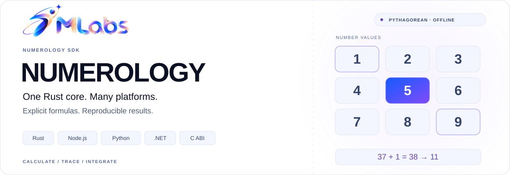
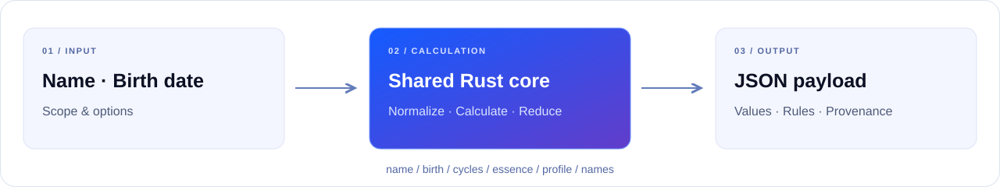

# 7mlabs Numerology SDK

<picture>
  <source media="(prefers-color-scheme: dark)" srcset="docs/assets/readme/hero.en.dark.svg">
  <source media="(prefers-color-scheme: light)" srcset="docs/assets/readme/hero.en.light.svg">
  
</picture>

[Tiếng Việt](README.md) · **English**

<p align="center">
<a href="LICENSE">
<picture>
  <source media="(prefers-color-scheme: dark)" srcset="docs/assets/readme/badge-license.dark.svg">
  <source media="(prefers-color-scheme: light)" srcset="docs/assets/readme/badge-license.light.svg">
  
</picture>
</a>
<picture>
  <source media="(prefers-color-scheme: dark)" srcset="docs/assets/readme/badge-rust.dark.svg">
  <source media="(prefers-color-scheme: light)" srcset="docs/assets/readme/badge-rust.light.svg">
  
</picture>
<picture>
  <source media="(prefers-color-scheme: dark)" srcset="docs/assets/readme/badge-offline.dark.svg">
  <source media="(prefers-color-scheme: light)" srcset="docs/assets/readme/badge-offline.light.svg">
  
</picture>
<a href="docs/rules.md">
<picture>
  <source media="(prefers-color-scheme: dark)" srcset="docs/assets/readme/badge-system.dark.svg">
  <source media="(prefers-color-scheme: light)" srcset="docs/assets/readme/badge-system.light.svg">
  
</picture>
</a>
</p>

[Quick start](#quick-start) · [Features](#features) · [Formulas](docs/features-and-formulas.md) · [JSON example](docs/examples/profile-response.json) · [Development](#development)

Offline Pythagorean calculations from one Rust core, with Node.js/TypeScript, Python, .NET and C interfaces. MIT License — Copyright (c) 2026 7mlabs.

SDK candidate: **1.1.0 — not published yet**. Registry availability and verified native targets are recorded in the release manifest. This is an independent SDK with a new JSON contract, not a drop-in replacement for the earlier HTTP service. It performs calculations directly inside the caller process, without an engine server or an Internet request.

<a id="features"></a>

## Features and formulas

**Current system:** Pythagorean. Requests and responses identify `system=pythagorean` and the versioned calculation rules. Unsupported systems return an error. Version 1.0.0 includes multi-name calculations and optional schema 1.1 features; the release manifest identifies the tested source commit and package hashes.

| Operation | What it calculates |
| --- | --- |
| `name` | Expression, Soul Urge, Personality, Balance, given/family name numbers, name-frequency grid, missing numbers, Hidden Passion, Subconscious Self, Cornerstone and Capstone. |
| `birth` | Life Path, Birthday, Attitude, reduced date components and the birth-digit grid. |
| `cycles` | Personal/universal year, month and day; four Pinnacles and four birth-date Challenges. |
| `essence` | Given/middle/family letter transits and Essence for an explicit age range. |
| `profile` | All base scopes plus Maturity and the Life Path–Expression / Soul Urge–Personality Bridges. |
| `names` | Independent results for several names plus only caller-selected combinations; optional scoped Rational Thought. |

Opt-in additions in 1.0.0 include single-digit display roots alongside retained masters, Rational Thought, three Period Cycles, neutral grid-axis coverage, separate current-name numbers, combined grids, profile name sets, and two sourced first/last-letter name Challenges. The exact activation and output scope are documented below. Expression Challenge and the comparison website's “Năng lực trưởng thành” remain unimplemented pending formula verification.

**Public calculation documentation:**

- [Feature catalog and formulas](docs/features-and-formulas.md): inputs, every supported indicator, exact arithmetic, output paths and scope boundaries.
- [Exact conventions and edge cases](docs/rules.md): master retention, Y classification, name normalization/order, age bands and collection validation.
- [Formula evidence and unresolved methods](docs/formula-verification.md): sources, published examples, zero policies and methods not inferred from one website result.
- [Synthetic request](docs/examples/profile-request.json) and [actual engine response](docs/examples/profile-response.json): reproducible payload with calculation traces, current name and one selected group.

The documentation explains the arithmetic without putting a textbook into every payload. Payload metadata records the effective system, rule versions, options, reduction traces and explicit sources needed to select and reproduce those documented methods.

## Filtered output in 1.1.0

Prefer `calculateFiltered` for new integrations that need less source data. It retains eligible raw totals, reduction steps, masters and single-digit display values, with explicit date-revealing trace exceptions for Attitude/Rational Thought. Existing `calculate` APIs still return full 1.0.0-compatible output, which can contain names and birth-date sources.

[Field policy, limits and examples](docs/payload-filtering.md). Filtered output **is not anonymous**. New API examples below require a built 1.1.0 candidate; public registry packages have not been changed during candidate preparation.

## From input to payload

<picture>
  <source media="(prefers-color-scheme: dark)" srcset="docs/assets/readme/calculation-flow.en.dark.svg">
  <source media="(prefers-color-scheme: light)" srcset="docs/assets/readme/calculation-flow.en.light.svg">
  
</picture>

<a id="quick-start"></a>

## Calculate

```json
{"operation":"profile","system":"pythagorean","name":{"given":"An","middle":"Văn","family":"Nguyễn"},"birthDate":"2000-02-29","referenceDate":"2026-11-03"}
```

Name components are explicit so callers control cultural name order. `profile` returns name numbers, birth numbers, cycles, Essence and derived values. Use `name`, `birth`, `cycles` or `essence` independently to avoid unnecessary calculation and payload. Only `pythagorean` is implemented in this release; another system returns a structured error.

### Node.js / TypeScript

```js
const { calculate, calculateFiltered } = require('@7mlabs/numerology');
const result = calculateFiltered({ operation: 'birth', birthDate: '2000-02-29' });
console.log(result.data.birth.lifePath);
```

### Python

```python
from sevenmlabs_numerology import calculate, calculate_filtered
result = calculate_filtered({"operation": "birth", "birthDate": "2000-02-29"})
print(result["data"]["birth"]["lifePath"])
```

### .NET

```csharp
using SevenMLabs.Numerology;
var result = Numerology.CalculateFiltered("""{"operation":"birth","birthDate":"2000-02-29"}""");
Console.WriteLine(result.GetProperty("data").GetProperty("birth").GetProperty("lifePath"));
```

All wrappers expose a raw JSON envelope (`calculateJson`, `calculate_json`, `CalculateJson`), returning `ok` and either `result` or structured `error`. Convenience methods return the result and throw an error with a code/field on calculation failure. Success metadata includes engine/schema/rules versions and selected options. Inputs are not mutated. Results use the explicit date supplied by the caller and are deterministic across bindings. See [the complete rules](docs/rules.md) before comparing calculators using different conventions.

<details>
<summary><strong>Optional extended payload</strong></summary>

## Optional extended payload

This section describes the full `calculate` API. Omitting `extensions` keeps the existing schema 1.0 payload, values and Rust `Request` API unchanged. An explicit object opts into schema 1.1 additions:

```js
const result = calculate({
  operation: 'profile',
  name: { given: 'Ada', family: 'Lovelace' },
  birthDate: '1815-12-10',
  referenceDate: '2026-11-11',
  extensions: { currentName: { given: 'Ada' } }
});
console.log(result.data.name.soulUrge.reducedValue);
console.log(result.data.extended.rationalThought.number.value);
```

Every calculated number can include `reducedValue` without changing `value`, `steps`, master retention or karmic-debt markers. Display a retained master as `11/2`, `22/4` or `33/6`; do not label ordinary `10 → 1` as a master. Omit the slash form when `isMaster` is false.

`data.extended` contains the applicable additions for the requested operation: neutral grid-axis detection, three Period Cycles with integer age bands, Rational Thought from the birth given name, optional current-name numbers, and a combined birth/name grid. Current names never replace birth-name calculations. The source of each combined grid and Rational Thought is explicit. `extensions.reducedValues` and `extensions.indicators` default to true and can be disabled independently; a current name requires indicators and a `name` or `profile` operation. Rust callers can use `calculate_with_extensions(&request, &Extensions::default())` without changing existing `Request` literals.

These additions are part of SDK 1.0.0. Release packages are rebuilt from the verified source; the release manifest records the source commit and SHA-256 hashes. The extension rules are versioned separately as `pythagorean-7mlabs-extensions-1.0`; the base rules are unchanged. See [the extension rules and operation matrix](docs/rules.md#opt-in-extensions-payload-schema-11).

</details>

<details>
<summary><strong>Multiple names and selected combinations</strong></summary>

## Multiple names and selected combinations

`name` still calculates one supplied name. The new `names` operation calculates a list independently and only the combinations explicitly selected by the caller:

```js
const result = calculate({
  operation: 'names',
  birthDate: '2000-02-29', // optional; enables scoped Rational Thought
  names: [
    { id: 'legal', name: { given: 'Ada', family: 'Lovelace' } },
    { id: 'nick', name: { given: 'Map' } }
  ],
  combinations: [{
    id: 'given-and-nick',
    sources: [{ nameId: 'legal', part: 'given' }, { nameId: 'nick' }]
  }]
});
console.log(result.data.names.names);
console.log(result.data.names.combinations);
```

Each result has a stable caller ID. Combinations echo the selected sources, parts and normalized text, with `method=concatenateSelectedParts` and `reduction=wholeNameSum`. Selected original letter values are summed before reduction; previously reduced results are not added together. No default combination or astrological interpretation is inferred.

Profiles opt in with `extensions.nameSet`: put additional names in its `names` list and desired groups in `combinations`. The birth name is automatically available as reserved ID `birth`. The output is `data.extended.nameSet`. Existing birth-name calculations, `currentName`, and the current combined-grid selection are unchanged. Reference `{nameId:'birth', part:'given'}` for the birth given name or `part:'full'` for all its parts.

Parts are `given`, `middle`, `family`, or `full` (default, expanded in given/middle/family order). Each combination preserves source order and inserts spaces between nonempty parts. Identical normalized individual names may retain distinct IDs; using duplicate text or overlapping parts in a group returns a structured error. Unknown IDs, group-to-group references, empty selected parts and duplicate IDs are rejected. Limits: 32 input names (including `birth` in a profile), 32 combinations, 2–32 sources per group, 4096 bytes of normalized combined text, and the existing 16 KiB JSON request limit. See [the complete name-set rules](docs/rules.md#multiple-names-and-explicit-combinations).

</details>

<details>
<summary><strong>Explicit name challenges</strong></summary>

## Explicit name challenges

Two sourced name challenges are available only when requested for `name` or `profile`:

```js
const result = calculate({
  operation: 'name',
  name: { given: 'Dave', family: 'Jones' },
  extensions: { nameChallenges: { nameOrder: 'givenMiddleFamily' } }
});
console.log(result.data.extended.nameChallenges.birthName.personality.value); // 3
```

Choose `givenMiddleFamily` or `familyMiddleGiven` explicitly. Soul Urge Challenge is the absolute difference of the first/last vowel values, retaining zero. Personality Challenge uses the first/last consonant values and maps a zero difference to nine, following Roy Kirkland's published convention. Output includes ordered text, Y policy, endpoint letters/values, raw difference, final value, method and rule version. With no matching letters the result is `unavailable` with null values; one matching letter is a valid zero difference.

The optional `currentName` is calculated separately with the same requested order. This setting does not modify or automatically extend `nameSet` results; calculate another name through `name` or the Rust `calculate_name_challenges` helper. It requires `indicators: true`; the existing `Request`, `Extensions`, `NamesRequest` and `NameSet` Rust layouts are preserved. No output changes when this setting is absent or null. See [formula evidence and unresolved website mappings](docs/formula-verification.md).

</details>

<a id="development"></a>

## Build and verify

Rust 1.83+, Node.js 18+, Python 3.10+, .NET 8+ library target. Native binary availability is target-specific: release manifests enumerate targets actually built and tested; no Windows, WebAssembly, musl or other untested binary support is implied.

```sh
cargo test --workspace --locked
python3 scripts/collect-notices.py
python3 scripts/build-native.py
python3 scripts/make-conformance.py
node scripts/test-node.cjs
python3 scripts/test-python.py
dotnet run --project tests/dotnet/Consumer.csproj -- artifacts/conformance.json
```

`crates/` holds the Rust engine, C ABI, Node adapter and CLI; `bindings/` holds language wrappers; `include/` defines the C ABI. The private local legacy snapshot is excluded from version control and packages. Third-party notices ship with native packages. Native calls require valid C pointers as documented in the header; use the managed wrappers for ordinary input validation.
