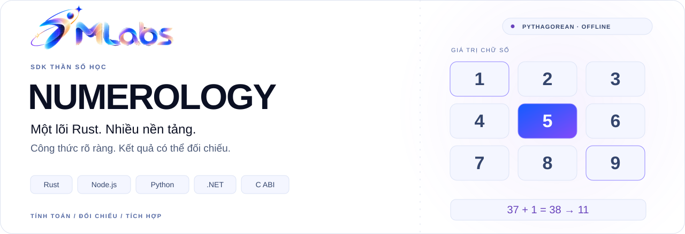

# 7mlabs Numerology SDK



**Tiếng Việt** · [English](https://github.com/7mlabs-workspace/sdk-numerology/blob/main/README.en.md)

[](https://github.com/7mlabs-workspace/sdk-numerology/blob/main/LICENSE)


[](https://github.com/7mlabs-workspace/sdk-numerology/blob/main/docs/rules.vi.md)
[Bắt đầu](#cách-gọi-cơ-bản) · [Chức năng](#chức-năng-hiện-có) · [Công thức](https://github.com/7mlabs-workspace/sdk-numerology/blob/main/docs/features-and-formulas.vi.md) · [Ví dụ JSON](https://github.com/7mlabs-workspace/sdk-numerology/blob/main/docs/examples/profile-response.json) · [Phát triển](#dựng-và-kiểm-thử)

SDK thần số học Pythagorean do **7mlabs phát triển**, tính ngoại tuyến bằng một lõi Rust dùng chung cho Node.js/TypeScript, Python, .NET và giao diện C. Giấy phép MIT — Copyright (c) 2026 7mlabs.

Phiên bản SDK: **1.0.0**. Bản này gồm các chức năng nhiều tên và phần mở rộng tùy chọn mô tả bên dưới. Tệp gói chính thức và nền tảng native đã kiểm chứng được ghi trong bản kê phát hành. Đây là SDK độc lập với hợp đồng JSON riêng, không phải bản thay thế trực tiếp dịch vụ HTTP cũ. Phép tính chạy ngay trong tiến trình ứng dụng, không cần máy chủ engine hay Internet.

## Chức năng hiện có

Hiện chỉ hỗ trợ **Pythagorean**. Đầu vào/đầu ra ghi `system=pythagorean` và phiên bản bộ quy tắc; trường phái chưa hỗ trợ trả lỗi, không tự dùng công thức của hệ khác.

| Chức năng | Nội dung tính toán |
| --- | --- |
| `name` | Sứ mệnh, Linh hồn, Nhân cách, Cân bằng, chỉ số given/family, biểu đồ tên, số thiếu, Đam mê tiềm ẩn, Tiềm thức, chữ đầu Cornerstone và chữ cuối Capstone. |
| `birth` | Đường đời, Ngày sinh, Thái độ, các thành phần ngày đã rút gọn và biểu đồ ngày sinh. |
| `cycles` | Năm/tháng/ngày cá nhân và thế giới; bốn Đỉnh cao, bốn Thử thách ngày sinh. |
| `essence` | Chuyển chữ theo given/middle/family và Essence trong khoảng tuổi được chọn. |
| `profile` | Toàn bộ phạm vi cơ bản, Trưởng thành và hai Cầu nối Đường đời–Sứ mệnh / Linh hồn–Nhân cách. |
| `names` | Nhiều tên tính riêng, các nhóm ghép do bên gọi chọn; thêm Tư duy theo phạm vi khi có ngày sinh. |

Các phần mở rộng trong **1.0.0**, cần bật rõ: số rút gọn hiển thị bên cạnh master, Tư duy, ba Giai đoạn, độ phủ trục biểu đồ, tên thường gọi riêng, biểu đồ kết hợp, danh sách tên trong hồ sơ và hai Thử thách theo chữ đầu–cuối có nguồn công thức. Chưa thêm Thử thách Sứ mệnh và “Năng lực trưởng thành” theo website đối chiếu vì chưa xác minh được cách tính.

## Tài liệu tiếng Việt

- [Chức năng và công thức](https://github.com/7mlabs-workspace/sdk-numerology/blob/main/docs/features-and-formulas.vi.md): đầu vào, từng chỉ số, phép tính cụ thể và vị trí trong payload.
- [Quy tắc chi tiết](https://github.com/7mlabs-workspace/sdk-numerology/blob/main/docs/rules.vi.md): giữ master, chữ Y, chuẩn hóa/thứ tự tên, tuổi và giới hạn nhóm ghép.
- [Kiểm chứng công thức](https://github.com/7mlabs-workspace/sdk-numerology/blob/main/docs/formula-verification.vi.md): nguồn, ví dụ đã công bố, cách xử lý 0 và phương pháp chưa xác minh.
- [Yêu cầu giả lập](https://github.com/7mlabs-workspace/sdk-numerology/blob/main/docs/examples/profile-request.json) và [phản hồi thật của engine](https://github.com/7mlabs-workspace/sdk-numerology/blob/main/docs/examples/profile-response.json): ví dụ có các bước rút gọn, tên thường gọi và một nhóm ghép.

Tài liệu giải thích công thức; payload ghi trường phái, phiên bản quy tắc, tùy chọn thực tế, các bước rút gọn và nguồn dữ liệu cần thiết để tái lập cách tính. Tên hàm, operation và trường JSON giữ nguyên tiếng Anh trên mọi ngôn ngữ tài liệu.

## Từ đầu vào đến payload


## Cách gọi cơ bản

```json
{"operation":"profile","system":"pythagorean","name":{"given":"An","middle":"Văn","family":"Nguyễn"},"birthDate":"2000-02-29","referenceDate":"2026-11-03"}
```

Tên gồm given, middle, family được gán rõ để bên tích hợp chủ động theo cấu trúc tên. Profile trả các chỉ số tên, ngày sinh, chu kỳ, Essence và chỉ số kết hợp. Có thể gọi name, birth, cycles, essence riêng để giới hạn phép tính và dữ liệu đầu ra. Chỉ Pythagorean được triển khai; hệ khác nhận lỗi có cấu trúc.

### Node.js / TypeScript

```js
const { calculate } = require('@7mlabs/numerology');
const result = calculate({ operation: 'birth', birthDate: '2000-02-29' });
console.log(result.data.birth.lifePath);
```

### Python

```python
from sevenmlabs_numerology import calculate
result = calculate({"operation": "birth", "birthDate": "2000-02-29"})
print(result["data"]["birth"]["lifePath"])
```

### .NET

```csharp
using SevenMLabs.Numerology;
var result = Numerology.Calculate("""{"operation":"birth","birthDate":"2000-02-29"}""");
Console.WriteLine(result.GetProperty("data").GetProperty("birth").GetProperty("lifePath"));
```

Các binding có hàm JSON thô `calculateJson`, `calculate_json`, `CalculateJson`, trả `ok` cùng `result` hoặc `error` có cấu trúc. Hàm tiện ích trả trực tiếp result, ném lỗi có code/field khi tính thất bại. Kết quả thành công ghi phiên bản engine/schema/quy tắc và cấu hình được chọn. Không sửa đầu vào; cùng đầu vào và ngày tham chiếu cho cùng kết quả qua các binding. Xem [quy tắc đầy đủ](https://github.com/7mlabs-workspace/sdk-numerology/blob/main/docs/rules.vi.md) trước khi so với website có quy ước khác.

## Payload mở rộng tùy chọn

Bỏ `extensions` để giữ payload schema 1.0, giá trị và API Rust Request cũ. Truyền đối tượng để chọn các phần bổ sung schema 1.1:

```js
const result = calculate({
  operation: 'profile',
  name: { given: 'Ada', family: 'Lovelace' },
  birthDate: '1815-12-10',
  referenceDate: '2026-11-11',
  extensions: { currentName: { given: 'Ada' } }
});
console.log(result.data.name.soulUrge.reducedValue);
console.log(result.data.extended.rationalThought.number.value);
```

Đối tượng số có thể thêm `reducedValue` mà không đổi value, steps, chính sách master hoặc dấu nợ nghiệp. Có thể hiển thị master được giữ thành 11/2, 22/4, 33/6; số thường 10 → 1 không phải master. Không dùng dạng master khi isMaster=false.

`data.extended` chỉ chứa phần phù hợp với operation: độ phủ trục, ba Giai đoạn theo tuổi nguyên, Tư duy từ given khai sinh, tên thường gọi tùy chọn và biểu đồ ngày sinh/tên kết hợp. Tên thường gọi không thay phép tính tên khai sinh. Mỗi biểu đồ kết hợp/Tư duy ghi nguồn rõ. reducedValues và indicators mặc định true, tắt độc lập; currentName cần indicators=true và operation name/profile. Rust có `calculate_with_extensions(&request, &Extensions::default())`, không cần sửa cấu trúc Request cũ.

Các phần mở rộng thuộc SDK 1.0.0. Gói phát hành phải được dựng từ đúng source và kiểm chứng trên từng nền tảng; bản kê phát hành ghi mã commit và mã kiểm tra SHA-256. Mã quy tắc mở rộng riêng là `pythagorean-7mlabs-extensions-1.0`, quy tắc cơ bản không đổi. Xem [ma trận phần mở rộng](https://github.com/7mlabs-workspace/sdk-numerology/blob/main/docs/rules.vi.md#phan-mo-rong).

## Nhiều tên và nhóm ghép được chọn

Name tiếp tục tính một tên. Operation names mới tính từng tên độc lập và chỉ ghép nhóm được bên gọi yêu cầu:

```js
const result = calculate({
  operation: 'names',
  birthDate: '2000-02-29', // tùy chọn; bật Tư duy theo phạm vi
  names: [
    { id: 'legal', name: { given: 'Ada', family: 'Lovelace' } },
    { id: 'nick', name: { given: 'Map' } }
  ],
  combinations: [{
    id: 'given-and-nick',
    sources: [{ nameId: 'legal', part: 'given' }, { nameId: 'nick' }]
  }]
});
console.log(result.data.names.names);
console.log(result.data.names.combinations);
```

Mỗi kết quả có ID ổn định của bên gọi. Nhóm trả lại nguồn, phần tên và chuỗi chuẩn hóa, ghi method=concatenateSelectedParts, reduction=wholeNameSum. Cộng giá trị chữ gốc trước khi rút, không cộng các kết quả đã rút. Không tự sinh nhóm ghép hay luận giải.

Profile bật `extensions.nameSet`, truyền tên thêm trong names và nhóm trong combinations. Tên khai sinh có sẵn bằng ID dành riêng `birth`. Đầu ra ở `data.extended.nameSet`. Không thay các chỉ số khai sinh, currentName hay nguồn biểu đồ kết hợp. Dùng `{nameId:'birth',part:'given'}` để chọn given khai sinh, hoặc full cho toàn bộ thành phần.

Các phần chọn là given, middle, family, full; full mặc định ghép theo given/middle/family. Giữ thứ tự nguồn, ngăn các phần không rỗng bằng khoảng trắng. Tên riêng trùng sau chuẩn hóa vẫn giữ ID khác nhau; nhóm chọn chuỗi trùng hoặc phần chồng nhau thì báo lỗi. Từ chối ID không có, tham chiếu nhóm khác, phần được chọn rỗng và ID trùng. Giới hạn: 32 tên gồm birth trong profile, 32 nhóm, 2–32 nguồn/nhóm, 4096 byte chuỗi ghép chuẩn hóa và 16 KiB toàn yêu cầu JSON. Xem [quy tắc nhiều tên](https://github.com/7mlabs-workspace/sdk-numerology/blob/main/docs/rules.vi.md#nhieu-ten).

## Thử thách theo tên

Hai Thử thách có nguồn công thức chỉ xuất hiện khi yêu cầu rõ trên name/profile:

```js
const result = calculate({
  operation: 'name',
  name: { given: 'Dave', family: 'Jones' },
  extensions: { nameChallenges: { nameOrder: 'givenMiddleFamily' } }
});
console.log(result.data.extended.nameChallenges.birthName.personality.value); // 3
```

Phải chọn givenMiddleFamily hoặc familyMiddleGiven. Thử thách Linh hồn là trị tuyệt đối hiệu giá trị nguyên âm đầu–cuối, giữ 0. Thử thách Nhân cách dùng phụ âm đầu–cuối và đổi hiệu 0 thành 9 theo quy ước Roy Kirkland. Kết quả ghi chuỗi theo thứ tự, cách xử lý Y, hai chữ và giá trị, hiệu gốc, kết quả cuối, phương pháp và mã quy tắc. Không có chữ đúng loại thì unavailable với giá trị null; một chữ đúng loại cho hiệu 0 hợp lệ.

CurrentName được tính riêng với cùng thứ tự đã chọn. Tùy chọn này không tự mở rộng kết quả nameSet; tên khác có thể tính qua name hoặc hàm Rust calculate_name_challenges. Cần indicators=true. Giữ nguyên cấu trúc Rust Request, Extensions, NamesRequest, NameSet; không bật hoặc truyền null thì không đổi đầu ra cũ. Xem [căn cứ và phương pháp chưa xác minh](https://github.com/7mlabs-workspace/sdk-numerology/blob/main/docs/formula-verification.vi.md).

## Dựng và kiểm thử

Yêu cầu Rust 1.83+, Node.js 18+, Python 3.10+, thư viện .NET nhắm .NET 8+. Tệp native phụ thuộc nền tảng; bản kê phát hành nêu đúng nền tảng đã dựng và kiểm thử, không mặc nhiên hứa hỗ trợ Windows, WebAssembly, musl hay nền tảng chưa thử.

```sh
cargo test --workspace --locked
python3 scripts/collect-notices.py
python3 scripts/build-native.py
python3 scripts/make-conformance.py
node scripts/test-node.cjs
python3 scripts/test-python.py
dotnet run --project tests/dotnet/Consumer.csproj -- artifacts/conformance.json
```

`crates/` chứa engine Rust, C ABI, bộ nối Node và CLI; `bindings/` chứa lớp tích hợp các ngôn ngữ; `include/` định nghĩa C ABI. Bản chụp dịch vụ cũ riêng tư ở máy không đưa vào git/gói. Thông báo thư viện bên thứ ba được đóng kèm gói native. Lời gọi C cần con trỏ hợp lệ theo header; ứng dụng thông thường dùng binding để kiểm tra đầu vào.
